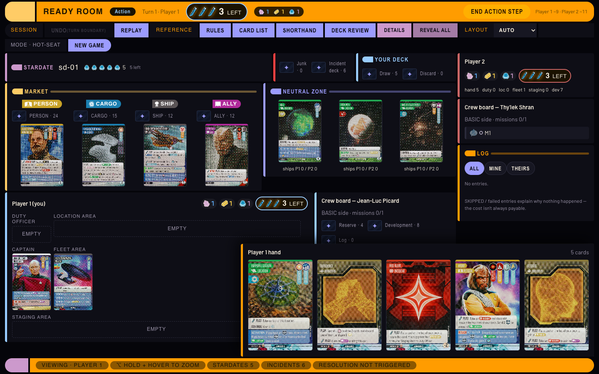
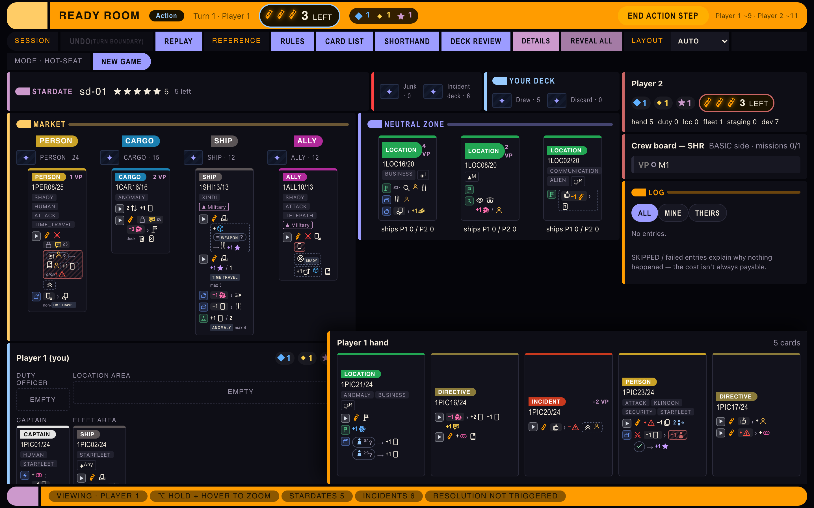
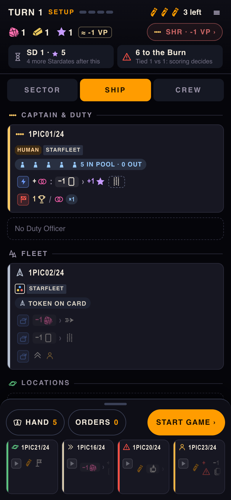
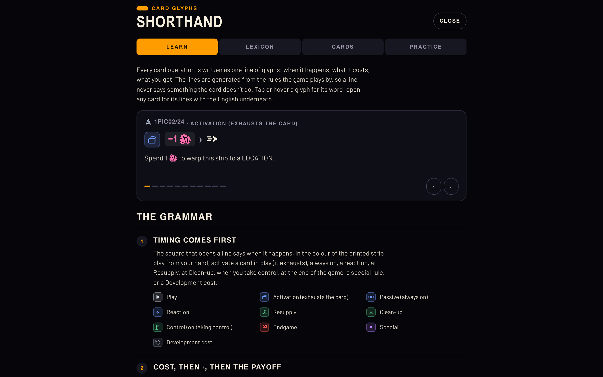

# Ready Room

An unofficial, fan-made rules engine and web app for playing
[_Star Trek: Captain's Chair_](https://boardgamegeek.com/boardgame/422541/star-trek-captains-chair)
(WizKids, 2024 — designed by Dávid Turczi & Nigel Buckle) in the browser: hot-seat on one screen,
against our own House AI, or asynchronously online against a friend, on desktop or phone, with
replay, undo and saved games.

> [!WARNING]
> **This is still being tested.** Every card is implemented and the engine has a
> large automated test suite, but the game has seen little real play yet. Expect rules bugs,
> cards that resolve slightly wrong, rough edges in the UI, and save files that may not load in a
> later version. Bug reports are very welcome — please attach the exported session (Replay →
> Export .json) so the game can be replayed exactly.



<sub>**Disclaimer:** the card art and card text in this screenshot are © WizKids and are shown only
to illustrate what the app looks like once the card database is fetched. The card scans come from
the [STCC Card Database](https://periodic-agent.github.io/stcc-strategy/) and are **not**
distributed with this repository. Star Trek and related marks are trademarks of CBS Studios Inc.
This project is not affiliated with or endorsed by WizKids or CBS.</sub>

Without the card database, cards show their number and the app's own shorthand glyphs:



<p align="center">
  
  &nbsp;&nbsp;
  
</p>

## No cards in this repository

**This repository contains no card images, no printed card text and no rulebook** — apart from
the one illustrative screenshot above. Those belong to WizKids and CBS. The game gets its cards
from the community-maintained
**[STCC Card Database](https://periodic-agent.github.io/stcc-strategy/)**: `npm run fetch-cards`
downloads card scans, rules text and icons from it onto your own machine. Put the two together and
you have the full game, while neither repository redistributes the other's material.

You still need to know the rules — [buy the game](https://wizkids.com/).

## Desktop app

Prebuilt apps for **macOS** and **Windows** are on the
[Releases page](https://github.com/rwolffgang/ready-room/releases). On first launch the app
downloads the STCC card database (about 340 MB) onto your computer, the same way
`npm run fetch-cards` does. The card database is not part of the download. The builds are not
code-signed, so the first launch needs one extra click:

- macOS: right-click the app → **Open**.
- Windows: SmartScreen → **More info** → **Run anyway**.

See [`docs/desktop.md`](docs/desktop.md) for details.

## Installation from source

**You need:** [Node.js](https://nodejs.org/) 22 or newer (with npm), git, and an internet
connection for the card download.

```bash
git clone https://github.com/rwolffgang/ready-room.git
cd ready-room
npm install
npm run fetch-cards
npm run dev
```

Then open <http://localhost:5173>, pick two captains and press **Start game**.

`npm run fetch-cards` downloads the STCC card database (about 340 MB of card scans plus JSON) into
`vendor/stcc/` and `public/stcc/`. Both folders are gitignored. The script pins a specific
upstream commit ([`tools/stcc-source.json`](tools/stcc-source.json)) so everyone plays with the
same data; run `npm run fetch-cards -- --latest` to move to the newest one. Without the download
the game still runs, but shows text-only cards like the second screenshot above.

### Updating

```bash
git pull
npm install
npm run fetch-cards   # only downloads again if the pinned commit changed
```

## Playing

- **Hot-seat:** both captains share one screen. Games autosave in the browser; **Continue a saved
  game** picks them up again, and a session can be exported and imported as a small file.
  Finished games stay in the list with their result and open on the Final Score screen.
- **Against the House AI:** **Play vs House AI** on the start screen, or set either seat to it
  (Easy / Normal / Hard). It is our own computer opponent, not the official solo Bot, which
  needs the solo rulebook ([`docs/bot.md`](docs/bot.md)). Its moves run in a ticker, and
  **AI turn** shows what each of its turns did, starting with what it did to you.
- **On a phone or tablet:** below 1080px wide the game switches to phone and tablet layouts, with
  every card's operations drawn as a short line of glyphs ([`docs/shorthand.md`](docs/shorthand.md)).
  **Learn the card glyphs** on the start screen teaches them.
- **Online, asynchronously:** run the game server next to the app and use **Play online**:

  ```bash
  npm run server -- --host 0.0.0.0   # authoritative game server, port 8787
  npm run dev -- --host              # the app, reachable from phones on your network
  ```

  Hail a captain under Hails: pick yours and send the invite link. Your friend picks theirs when
  they open it and takes the first turn; each of you plays on your own device. Details, decisions
  and known limits: [`docs/ui-mobile.md`](docs/ui-mobile.md).

- **Hosted on the internet:** a single Fly.io machine (about $4/month) runs the server and the app
  from one address — see [`docs/deploy.md`](docs/deploy.md).

## How it works

**Card effects are data, not code.** Every card is a JSON definition (`src/data/cards/`) whose
operations are trees in a typed **effect DSL** ([`docs/effect-dsl.md`](docs/effect-dsl.md)).
A single **halting stack machine** ([`docs/state-machine.md`](docs/state-machine.md)) interprets
them. The engine is pure and serialisable, which makes replay, undo, deterministic tests and
mid-effect saves straightforward. REACTIONs can interrupt a resolving operation because the stack
is data rather than the JS call stack.

The card definitions carry mechanics only: suit, traits, skills, VP and effect trees. Names and
printed wording are joined in at runtime from the fetched database by card number (`1PIC08/24` =
Picard card 8 of 24); see `src/data/stcc.ts`.

```
src/engine/   rules engine: resolver, turn structure, market, scoring
src/data/     card definitions (mechanics only) and the STCC join layer
src/ui/       React UI (desktop, phone, online play)
server/       authoritative game server for online play
rules/        the rules, restructured in our own words for implementation
docs/         architecture, data model, effect DSL, state machine, UI spec
tools/        fetch-stcc, card validation, STCC cross-check, publish audit
```

## Development

```bash
npm test                          # vitest (runs without fetched data)
npm run lint
npm run build                     # validates cards, runs the publish audit, type-checks, builds
npx tsx tools/crosscheck-stcc.ts  # compare our card defs against the STCC database
npm run game                      # summarise the newest local game (while npm run dev runs)
```

While `npm run dev` runs, every autosave of a local game is also written to
`.debug/games/<id>.json` (gitignored). `npm run game` replays the newest one and prints the turn,
phase, zones with card names, the pending choice and the end of the log. `-- --list`,
`-- <id>`, `-- --at N`, `-- --log N`, `-- --intents` and `-- --state` pick another game, an
earlier point, a longer log or the raw JSON.

## Credits

- **Card data, scans and icons:** the [STCC Card Database](https://periodic-agent.github.io/stcc-strategy/)
  ([periodic-agent/stcc-strategy](https://github.com/periodic-agent/stcc-strategy)). Card data
  was entered by Periodic_agent, Assmatt, Esquire_Sandwich, Lynette T and Dreadreaper, and card
  scans come from Periodic_agent, Seth Bryant and pepper0nc1n1. Please support their work.
- **The game:** _Star Trek: Captain's Chair_ is designed by Dávid Turczi and Nigel Buckle
  (_To Boldly Go_ with Adam Turczi) and published by WizKids.

This is unofficial fan content, and neither WizKids nor CBS endorses or is affiliated with it.
Card images and text are © WizKids. Star Trek and related marks are trademarks of CBS Studios Inc.

## License

The code in this repository is MIT-licensed (see [LICENSE](LICENSE)). The license covers only
the code written here, not the game, its cards, its art or its rules text.

## Native iPadOS build

The native shell has an iPadOS configuration and touch-tablet layout selection.
See [docs/ipados.md](docs/ipados.md) for Xcode setup, first-run card download,
offline play, and signing/distribution steps. Start with `npm run ios:check`.

## Play on iPad through GitHub Pages

The GitHub Pages build supports Safari and Add to Home Screen, with local card
storage for offline play. See [docs/github-pages.md](docs/github-pages.md) for
publishing and installation. No Xcode is needed for this version.
