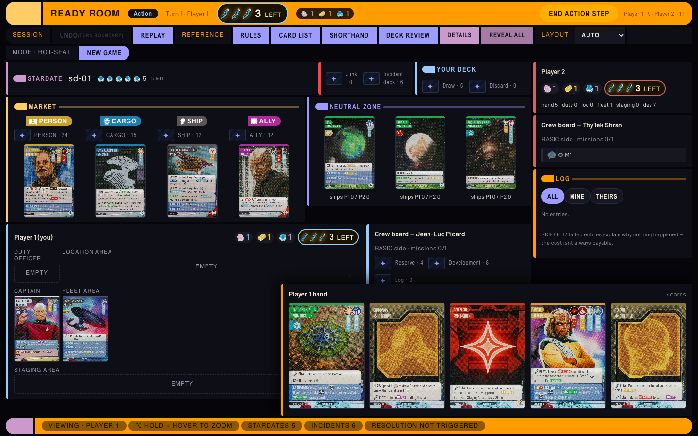
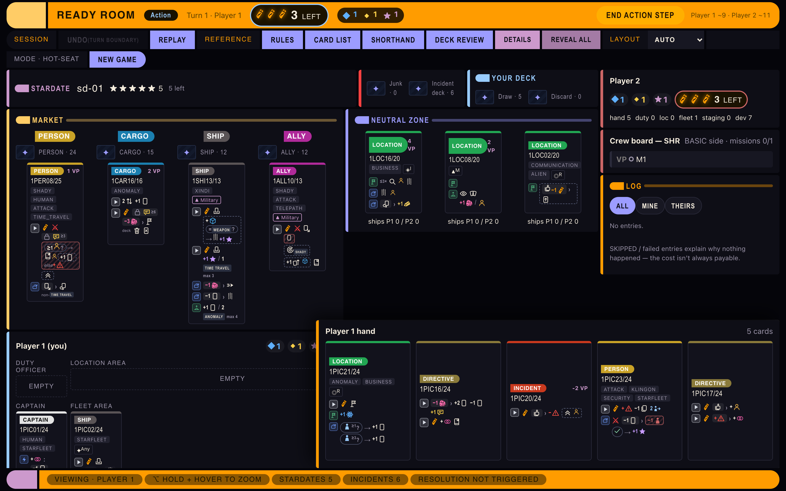
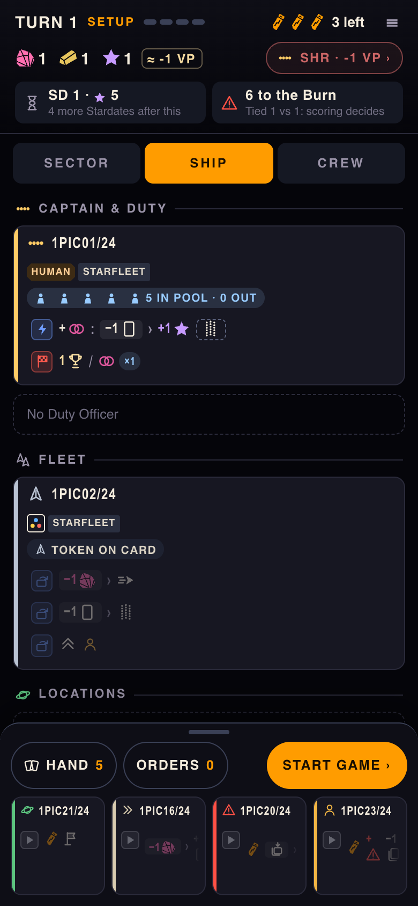
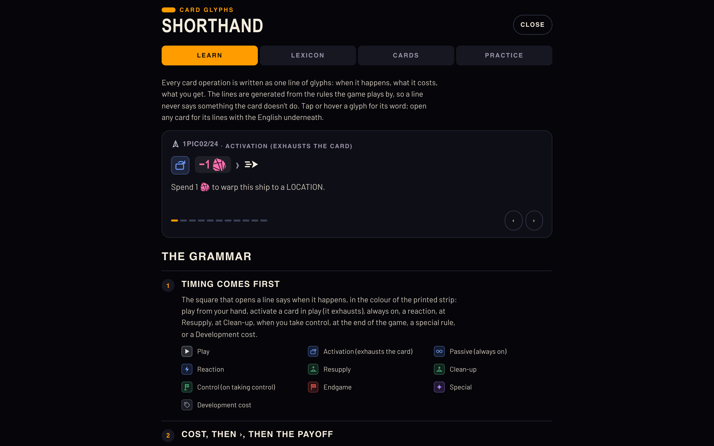

# Ready Room

Ready Room lets you play
[_Star Trek: Captain's Chair_](https://boardgamegeek.com/boardgame/422541/star-trek-captains-chair),
the 2024 WizKids deck-builder by Dávid Turczi and Nigel Buckle, in a web browser. It is a fan
project with no official standing. Two people can share one screen, you can take on a computer
opponent built for this project, or you can play a friend online with each of you taking turns
whenever it suits you. It runs on computers, tablets and phones, and every game can be saved,
rewound move by move and watched again afterwards.

> [!WARNING]
> **Treat this as a test version.** All of the cards have been built and thousands of automated
> checks run against the rules engine, but very few full games have been played by people so
> far. You may hit a rule that is handled wrongly, a card that does not behave quite as printed,
> a clumsy screen, or a saved game that an update can no longer open. If something goes wrong,
> please report it and include the game file (Replay → Export .json), which lets the exact game
> be played back.



<sub>**Note on the picture above:** the cards' artwork and wording belong to WizKids. They appear
here only to show how the game looks after the card database has been downloaded. The scans are
taken from the [STCC Card Database](https://periodic-agent.github.io/stcc-strategy/) and do
**not** come bundled with this project. Star Trek and its associated marks are trademarks of CBS
Studios Inc. WizKids and CBS have no connection to this project and have not approved it.</sub>

If the card database has not been downloaded, each card is drawn with its card number and a
compact set of symbols created for this project:



<p align="center">
  
  &nbsp;&nbsp;
  
</p>

## Where the cards come from

Apart from the sample picture at the top, you won't find card scans, card wording or the
rulebook stored here; that material is owned by WizKids and CBS. Instead, the cards are loaded
from the **[STCC Card Database](https://periodic-agent.github.io/stcc-strategy/)**, a project
run by fans of the game. Running `npm run fetch-cards` copies the scans, card text and symbols
from it onto your own computer. The two projects together make a complete game, and each keeps
its own material.

Knowing how to play is up to you, so [pick up a copy of the game](https://wizkids.com/).

## Installing the app

Ready-made versions for **Windows** and **macOS** are published on the
[Releases page](https://github.com/rwolffgang/ready-room/releases). The installer does not
include the card database: the first time the app opens, it downloads it (roughly 340 MB),
which is the same thing `npm run fetch-cards` does. Because the apps are not signed, your
computer will ask you to confirm the first time you open one:

- On a Mac, right-click the app and choose **Open**.
- On Windows, when SmartScreen appears, click **More info** and then **Run anyway**.

[`docs/desktop.md`](docs/desktop.md) has the full details.

## Running it from the source code

**Before you start, install** [Node.js](https://nodejs.org/) version 22 or later (npm comes with
it) and git. You'll also need to be online to download the cards.

```bash
git clone https://github.com/rwolffgang/ready-room.git
cd ready-room
npm install
npm run fetch-cards
npm run dev
```

Next, go to <http://localhost:5173> in your browser, choose a captain for each side and click
**Start game**.

The `npm run fetch-cards` step saves the STCC card database (around 340 MB of scans and JSON
files) to `vendor/stcc/` and `public/stcc/`, two folders that git ignores. It always fetches one
particular version of the database, recorded in
[`tools/stcc-source.json`](tools/stcc-source.json), so every player has identical cards. To
switch to the most recent version instead, run `npm run fetch-cards -- --latest`. You can play
without downloading anything; the cards will just appear as text, as in the second picture
above.

### Getting the latest version

```bash
git pull
npm install
npm run fetch-cards   # skipped unless the recorded database version has changed
```

## Ways to play

- **Two players, one screen:** take turns on the same device. The browser saves the game as you
  go, and **Continue a saved game** brings back anything unfinished. Any game can be saved to a
  small file and loaded again later. Completed games remain listed with how they ended, and
  opening one shows its final scores.
- **Versus the computer:** choose **Play vs House AI** on the opening screen, or hand either seat
  to the computer, at Easy, Normal or Hard. This opponent was written for this project and is a
  different thing from the solo-mode Bot in the official game, which relies on the solo rulebook
  ([`docs/bot.md`](docs/bot.md)). Each of its moves scrolls past in a ticker, and **AI turn**
  sums up what it did during its turn, leading with anything that affected you.
- **Phones and tablets:** on a touch screen the game uses the same table layout as on a
  computer, scaled to fit the screen. A phone layout is also available from the menu; it shows
  each card's abilities as a short row of symbols ([`docs/shorthand.md`](docs/shorthand.md)),
  and **Learn the card glyphs** on the opening screen explains them.
- **Online, at your own pace:** start the game server alongside the app, then choose **Play
  online**:

  ```bash
  npm run server -- --host 0.0.0.0   # the game server, which has the final say, on port 8787
  npm run dev -- --host              # the app, visible to phones on the same network
  ```

  Under Hails, choose your captain and send your friend the invite link. When they open it they
  choose their own captain and move first, and from then on each of you plays on your own
  device. [`docs/ui-mobile.md`](docs/ui-mobile.md) explains how this works and what it can't do
  yet.

- **On a server of your own:** one small Fly.io machine, costing roughly $4 a month, can serve
  both the game server and the app from a single web address. The steps are in
  [`docs/deploy.md`](docs/deploy.md).

## Under the hood

**What each card does is described in data rather than written as code.** Each card has a JSON
file in `src/data/cards/`, and its abilities are written as trees in a typed mini-language for
card effects ([`docs/effect-dsl.md`](docs/effect-dsl.md)). Those trees are carried out by one
interpreter that keeps its work on a stack and can pause at any point
([`docs/state-machine.md`](docs/state-machine.md)). Since the whole game state is plain data with
no hidden side effects, it is simple to replay a game, take moves back, write repeatable tests
and save in the middle of an ability. It also means a REACTION can jump in while another ability
is still resolving, since that stack lives in the game data and not inside JavaScript itself.

The card files hold only the game mechanics: suit, traits, skills, VP and the effect trees. A
card's name and printed text are looked up from the downloaded database while the game runs,
matched on the card number (`1PIC08/24` means the 8th of Picard's 24 cards); the code for this is
in `src/data/stcc.ts`.

```
src/engine/   the rules: effect resolution, turn order, the Market, scoring
src/data/     card definitions (mechanics only) and the link to the STCC data
src/ui/       the React interface (computer, phone and online play)
server/       the game server used for online games
rules/        the game rules, rewritten in our own words for building the engine
docs/         design notes: architecture, data model, effect DSL, state machine, UI
tools/        card download, card checks, comparison against the STCC data
sounds/       the sound effects and menu music, replaceable by name (see sounds/README.md)
```

## Working on the code

```bash
npm test                          # the vitest suite (needs no downloaded cards)
npm run lint
npm run build                     # checks the cards and types, then builds the app
npx tsx tools/crosscheck-stcc.ts  # look for differences between our cards and the STCC data
npm run game                      # summary of your latest local game (with npm run dev running)
```

Whenever `npm run dev` is running, each automatic save of a local game also lands in
`.debug/games/<id>.json`, which git ignores. `npm run game` plays the most recent of these back
and prints the turn and phase, what is in each zone (with card names), any choice waiting to be
made and the last part of the log. Add `-- --list`, `-- <id>`, `-- --at N`, `-- --log N`,
`-- --intents` or `-- --state` to choose a different game, stop at an earlier move, show more of
the log or dump the raw JSON.

## Credits

- **Card data, scans and icons:** the [STCC Card Database](https://periodic-agent.github.io/stcc-strategy/)
  ([periodic-agent/stcc-strategy](https://github.com/periodic-agent/stcc-strategy)). Card data
  was entered by Periodic_agent, Assmatt, Esquire_Sandwich, Lynette T and Dreadreaper, and card
  scans come from Periodic_agent, Seth Bryant and pepper0nc1n1. Please support their work.
- **The game:** _Star Trek: Captain's Chair_ is designed by Dávid Turczi and Nigel Buckle
  (_To Boldly Go_ with Adam Turczi) and published by WizKids.

This is unofficial fan content, and neither WizKids nor CBS endorses or is affiliated with it.
Card images and text are © WizKids. Star Trek and related marks are trademarks of CBS Studios Inc.

## License

The code in this repository is MIT-licensed (see [LICENSE](LICENSE)). The license covers only
the code written here, not the game, its cards, its art or its rules text.

## Playing in a browser on iPad or iPhone

A version of the game is published on GitHub Pages. It runs in Safari, can be added to the Home
Screen, and keeps the downloaded cards on the device so it works without a connection. Nothing
needs to be installed through Xcode. [docs/github-pages.md](docs/github-pages.md) explains how
to publish it and how to install it.

## Building a native iPad app

The app's native wrapper also has an iPadOS setup. [docs/ipados.md](docs/ipados.md) covers
setting up Xcode, the first download of the cards, offline play, and signing the app and sharing
it. Begin by running `npm run ios:check`.
